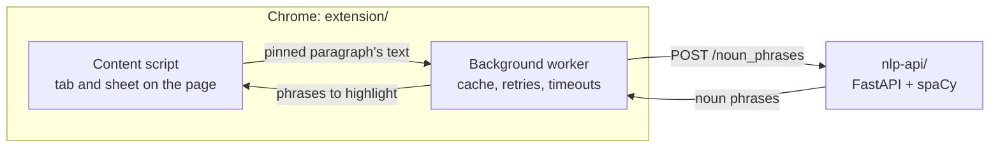

# Paragraph Processor

Word counts and noun-phrase highlighting for any paragraph on the web: a Chrome extension, and the small spaCy service that finds the noun phrases.

Made by [RGPL](https://rgpl.xyz).


Hover a paragraph to see its word count, and pin it to see its noun phrases highlighted in a copy of the text. The extension counts words in the browser and asks the service for the noun phrases.



| Folder | What it is | Built with | License |
|---|---|---|---|
| [`extension/`](extension) | The Chrome extension: the tab and sheet on the page, the toolbar popup, and the background worker that calls the service | TypeScript, Manifest V3, webpack; Vitest and Playwright | GPL-3.0-or-later |
| [`nlp-api/`](nlp-api) | The service: runs spaCy over batches of text and returns entities and noun phrases in Azure's custom-skill format | Python, FastAPI, spaCy; pytest | MIT |

## Running both

```bash
# The service, on http://localhost:8080
cd nlp-api
docker build -t nlp-spacy-api . && docker run -p 8080:8080 nlp-spacy-api
```

```bash
# The extension, in another terminal
cd extension
npm ci && npm run build
```

Then open `chrome://extensions`, switch on Developer mode, choose Load unpacked and pick `extension/dist`. Click the extension's toolbar button, switch on Noun phrase highlighting, and pin a paragraph on any page.

Each folder's README covers the rest: running the service without Docker, the extension's build settings, and how each part works.

## Tests

```bash
(cd extension && npm test && npm run e2e)
(cd nlp-api && pip install -r requirements-dev.txt && pytest)
```

The extension's e2e suite runs against a stub of the service, so the two suites don't depend on each other.

## History

The two parts started as separate repositories, `paragraph-processor-chrome` and `nlp-spacy-api`, and were brought together here in October 2026 with their full histories. Commits from before the move show the paths they had then.
