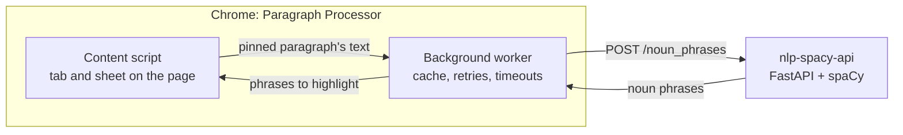

# nlp-spacy-api

A small FastAPI service that runs spaCy over batches of text and returns their named entities and noun phrases.

Made by [RGPL](https://rgpl.xyz).

It's the language side of [Paragraph Processor](https://github.com/rgpl-xyz/paragraph-processor-chrome), a Chrome extension that highlights the noun phrases in any paragraph you pin: the extension sends each pinned paragraph to `/noun_phrases` and marks up what comes back. Requests and responses use Azure AI Search's [custom skill format](https://learn.microsoft.com/azure/search/cognitive-search-custom-skill-interface), so the service also works as a custom skill there.



## Endpoints

| Route | Returns for each record |
|---|---|
| `POST /noun_phrases` | `noun_phrases`: the text's noun chunks |
| `POST /entities` | `entities`: each named entity with its label and every place it appears |
| `POST /entities_by_type` | entity names grouped by type, such as `people` or `organizations` |
| `POST /extract_all` | both `entities` and `noun_phrases` |
| `GET /health` | the model in use |

Interactive docs are at `/docs` once it's running.

```bash
curl -X POST http://localhost:8080/noun_phrases -H "Content-Type: application/json" \
  -d '{"values": [{"recordId": "1", "data": {"text": "The quick brown fox jumps over the lazy dog."}}]}'
```

```json
{"values": [{"recordId": "1", "data": {"noun_phrases": ["The quick brown fox", "the lazy dog"]}, "errors": null, "warnings": null}]}
```

A response has one record per request record, in the same order and with the same `recordId`. If one record can't be analyzed, for example because it's longer than the model's 1,000,000-character limit, that record gets a message in its `errors` and the rest of the batch still succeeds. A record whose `language` isn't English is still analyzed, with a note in its `warnings`.

## Running it

In a container:

```bash
docker build -t nlp-spacy-api .    # or podman
docker run -p 8080:8080 nlp-spacy-api
```

The image runs two uvicorn workers (`WEB_CONCURRENCY`), and each loads its own copy of the model.

With Python 3.10 or newer:

```bash
python3 -m venv .venv && source .venv/bin/activate
pip install -r requirements.txt    # pinned, includes the en_core_web_sm model
python main.py                     # http://localhost:8080
```

### Settings

`app/settings.py` reads these from the environment.

| Variable | Default | What it does |
|---|---|---|
| `PORT` | `8080` | Port for `python main.py` and the container |
| `SPACY_MODEL` | `en_core_web_sm` | The spaCy model package to load; install it first |
| `CORS_ALLOW_ORIGINS` | `*` | Comma-separated browser origins allowed to call the API |

## Tests

```bash
pip install -r requirements-dev.txt
pytest              # uses the real en_core_web_sm model; no server needed
pytest --cov=app    # with a coverage report
```

With a server running, `python scripts/smoke.py` calls every endpoint once and `python scripts/benchmark.py` times each one. Both take a base URL, defaulting to `$NLP_API_URL` or `http://localhost:8080`.

## How the code is laid out

- `app/api.py`: the routes and `create_app()`. The model loads when the server starts, and tests pass in their own loader.
- `app/analysis.py`: one spaCy pass per batch, giving every text's entities and noun phrases together. A text over the length limit is rejected on its own, and if a batch fails, each text is retried alone so the error lands on the one that caused it.
- `app/skill.py`: the custom-skill record format, so the routes differ only in which part of the analysis they return.
- `app/models.py` and `app/settings.py`: request and response models, and the environment settings.

The route handlers run in FastAPI's thread pool, so analyzing a batch doesn't hold up other requests such as `/health`.

## Credits

Started from Microsoft's [cookiecutter-spacy-fastapi](https://github.com/microsoft/cookiecutter-spacy-fastapi) template (MIT License); its copyright notices stay in the files that came from it.

## License

MIT, see [LICENSE](LICENSE).
